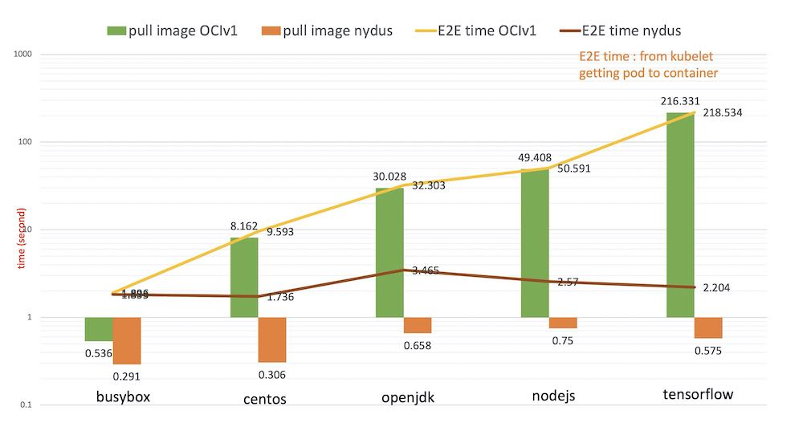
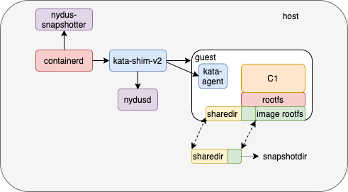

# Background

Research shows that time to take for pull operation accounts for 76% of container startup time but only 6.4% of that data is read. so if we can get data on demand (lazyload), it will speed up the container start. [Nydusd](https://github.com/dragonflyoss/image-service) is a project which build image with new format and can get data on demand when container start. Nydusd has supported runc containers.

The following benchmarking result shows the performance improvement compared with the OCI image for the container cold startup elapsed time on containerd. As the OCI image size increases, the container startup time of using Nydus image remains very short.



## Proposal - Bring lazyload ability to kata containers

Nydusd support Passthroughfs and [RAFS](https://github.com/dragonflyoss/image-service/blob/master/docs/nydus-design.md) (Registry Acceleration File System) natively, so in kata containers, we can use nydusd process in place of virtiofsd and mount nydus image to guest in the meanwhile.

The process of create/start kata containers with virtiofsd,

1. when create sandbox, kata-shim will launch virtiofsd before vm start, so vm can share dir with host.
2. when create container, kata-shim will mount `Mount` slice to ${bundle}/rootfs and bind mount rootfs to `sharedir`, so it can be seen in guest.

The process of create/start kata containers with nydusd,



1. when create sandbox, kata-shim should start nydusd and mount passthroughfs before vm start.

```bash
# start nydusd
/usr/local/bin/nydusd --log-level info  --sock /run/vc/vm/5502d6f9a404ccca94320d7d47f9225e25e05d193d521d713565c01811e480d5/vhost-user-fs.sock --apisock  /run/vc/vm/5502d6f9a404ccca94320d7d47f9225e25e05d193d521d713565c01811e480d5/api.sock
```

```bash
# mount passthroughfs
curl -v --unix-socket /run/vc/vm/5502d6f9a404ccca94320d7d47f9225e25e05d193d521d713565c01811e480d5/api.sock \
    -X POST "http://localhost/api/v1/mount?mountpoint=/foo1" -H "accept: */*" \
    -H "Content-Type: application/json" \
    -d '{
            "source":"${sharedir}",
            "fs_type":"passthrough_fs",
            "config":""
    }'
```

2. when create normal container, kata-shim send request to nydusd and nydusd mount `rafs` to guest. Kata-shim will also bind mount `snapshotdir` which nydus-snapshotter assign to sharedir, so in guest, container rootfs=overlay(lowerdir=`rafs`, upperdir=`snapshotdir/fs`, workdir=`snapshotdir/work`)

```bash
# mount rafs
# source: the metafile of nydus image
# config: the config of this image
curl --unix-socket /run/vc/vm/5502d6f9a404ccca94320d7d47f9225e25e05d193d521d713565c01811e480d5/api.sock \
    -X POST "http://localhost/api/v1/mount?mountpoint=/bar1" -H "accept: */*" \
    -H "Content-Type: application/json" \
    -d '{
            "source":"/var/lib/containerd/io.containerd.snapshotter.v1.nydus/snapshots/22/fs/image/image.boot",
            "fs_type":"rafs",
            "config":"{}",
    }'
```

> So the question is `how to transfer the rafs info from nydus-snapshotter to kata-shim?`

When create container, nydus-snapshotter will return `Mount` slice like below

```bash
[
    {
        Type: "overlay",
        Source: "overlay",
        Options: [lowerdir=lower_A:lower_B,upperdir=upper_A,workdir=work_A],
    }
]
```

Then, we can append rafs info into `Options`, but if do this, containerd will mount failed, because containerd can not identify rafs info. Here, we can refer to [containerd mount helper](https://github.com/containerd/containerd/blob/main/mount/mount_linux.go#L42) and provide a binary called `nydus-overlayfs`. The `Mount` slice which nydus-snapshotter returned becomes

```bash
[
    {
        Type: "fuse.nydus-overlayfs",
        Source: "overlay",
        Options: [lowerdir=lower_A:lower_B,upperdir=upper_A,workdir=work_A,extraoption=base64({source:xxx,config:xxx,snapshotdir:xxx})],
    }
]
```

When containerd find `Type` is `fuse.nydus-overlayfs`,

1. containerd will call `mount.fuse` command;
2. in `mount.fuse`, it will call `nydus-overlayfs`.
3. in `nydus-overlayfs`, it will ignore the `extraoption` and do the overlay mount.

Finally, in kata-shim, it parse `extraoption` and get the rafs info to mount the rafs in guest.
